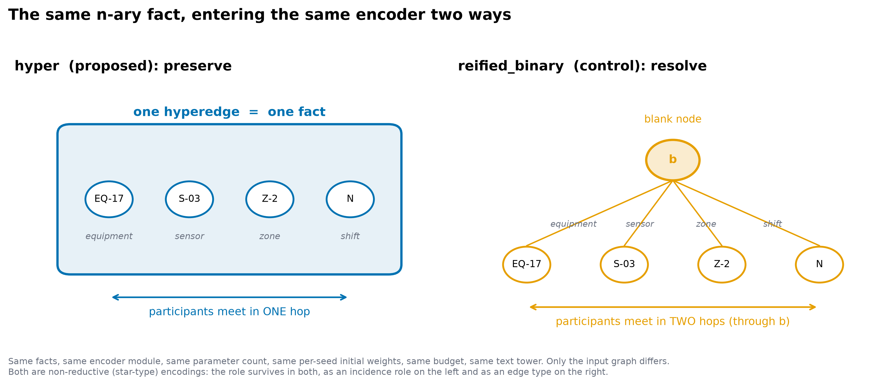
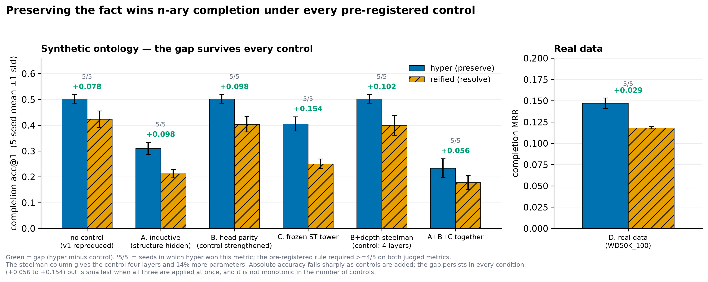
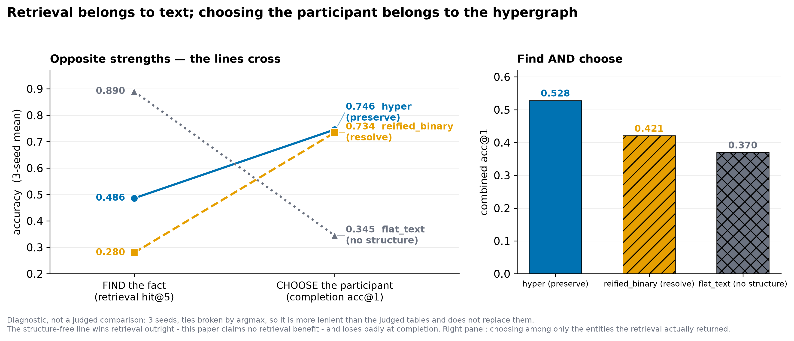

# Preserving N-ary Facts: Hyperedge Representation Beats Binary Reification in Ontology Encoders

> Status: **draft, not yet submitted.** English counterpart of `docs/hnn-ontology-paper1-draft.md`
> (Korean); both carry the same numbers from the same artifacts. Every headline number is checked
> against `outputs/hnn_ontology_encoder_v2/` by `.harness/scripts/verify_paper1_claims.py` (44 claims,
> 7 factors); the tests in §5.2 are produced by `.harness/scripts/paper1_statistics.py`.
> Any later edit must be applied to both versions.
>
> **2026-10-28:** the submission manuscript built from this draft is `papers/preserve_vs_reify/preserve_vs_reify.tex`
> (PDF alongside; build with `.harness/scripts/build_paper1_manuscript.sh`). It adds Studies 2 and 3, the related work
> from the papers in `papers/`, and corrections from a sentence-level audit. Edit the manuscript first from now on.

Alternative title: *Do Not Resolve What You Can Keep: N-ary Structure Preservation for Fact Completion*

---

## Abstract

Knowledge bases store many facts that involve more than two participants — a role assignment with a
person, a position, an organisation and a time span is one fact, not four. The standard encodings
(RDF-style n-ary relation patterns, Wikidata qualifiers) **resolve** such a fact into an intermediate
node plus a set of binary edges, because the underlying graph model only has binary edges to offer.
We ask whether that resolution costs anything measurable to a learned encoder.

We compare two encoders that are identical in every respect except how an n-ary fact enters them:
one **preserves** the fact as a single hyperedge over its participants, the other **resolves** it
into the standard blank-node-plus-binary-edges form. Both share the module, the vocabulary, the
parameter count, the per-seed initial weights, the training budget and the text tower; the judging
rule, metrics and seeds were frozen before any result was observed.

Preserving the fact is consistently better at **n-ary completion** — masking one participant and
ranking candidates — and the advantage survives four separate controls, each applied one at a time,
with the three synthetic-world controls also applied together: an inductive protocol that removes
the evaluated fact's structure from training, an output-head parity fix that strengthens the
control, a frozen multilingual sentence-transformer tower, and real Wikidata data (WD50K_100, mean
arity 3.30). Every factor passes on 5 of 5 seeds on both pre-registered metrics, including a
steelman that gives the resolved encoder twice the depth and 14% more parameters; all 14
seed-paired comparisons remain significant after Holm correction. Prior work showed that reified
graphs hurt knowledge-graph *embedding* methods; we show the cost persists for a message-passing
encoder once head asymmetry and depth are controlled.

We do not claim a retrieval benefit: a structure-free text baseline **beats** our proposal at
retrieval (recall@5 0.897 vs 0.846), an outcome the charter predicted before the run. We do not
claim competitive absolute numbers; the budget is small by design and state of the art was a stated
non-goal. And we report a negative result that bounds the finding: six pre-registered attempts to
transfer this encoder's advantage into a frozen decoder-only LLM all failed, never beating a bare
list of the retrieved entity names.

---

## 1. Background and terminology

- **N-ary fact.** A single fact with three or more participants, e.g. `(Kim, team lead, research
  lab, 2021–2023)`. Such facts are common in real ontologies; in our real dataset **every** fact has
  arity ≥ 3 (mean 3.30). This is the premise of the problem, not a result.
- **Hyperedge encoding (`hyper`, proposal).** The fact enters the encoder as one hyperedge over its
  participants, so "these participants form one fact" is never split apart.
- **Binary reification (`reified_binary`, judged control).** The same fact is written as one blank
  node plus one binary edge per participant — the pattern RDF and Wikidata use in practice. The
  information content is identical and only the representation differs, which makes it the right
  control. We strengthen it further in §3.2 so that it does not lose for an incidental reason.
- **`flat_text` (reference line, not judged).** Encodes only the fact's sentence, with no structure.
  It shows how far the task goes without structure and **does not enter the verdict**; it beats the
  proposal at retrieval (§6.1).
- **Retrieval recall@5.** Fraction of queries describing a fact for which the gold fact is ranked in
  the top five. **We make no absolute-superiority claim on this metric** (§6.1).
- **Completion acc@1 / Hits@10 / MRR.** One participant of a fact is masked and candidates are
  ranked: acc@1 is top-1 accuracy, Hits@10 top-10 accuracy, MRR the mean reciprocal rank. This task
  needs structure and is the paper's central metric.
- **Transductive / inductive.** Transductive: the evaluated fact's structure is in the training
  graph. Inductive: it is removed from training. Real ontologies keep receiving new facts, so the
  inductive setting is closer to practice (control A).
- **Pessimistic ties / filtered ranking.** Ties are broken against the gold answer, and other
  correct answers already known are removed from the candidate list so that a correct prediction is
  not counted as an error — the standard filtered setting [Bordes et al. 2013]. Both push the
  verdict toward strictness.

---

## 2. Problem setting and related work

Practice has already settled how to handle n-ary facts: resolve them. An RDF property is a binary
relation [Cyganiak et al. 2014], so n-ary relations are written through an intermediate individual
[Noy & Rector 2006]; Wikidata attaches qualifiers to a main statement [Vrandečić & Krötzsch 2014].
Both scatter one fact across several binary relations. That became standard not because it is more
expressive but **because the graph model only offers binary edges**.

**Relation to prior work.** The question is not new. Link prediction over n-ary facts has moved
toward methods that operate on the fact directly — NaLP [Guan et al. 2019], HINGE [Rosso et al. 2020],
HypE on knowledge hypergraphs [Fatemi et al. 2020], StarE, which encodes qualifiers by message
passing [Galkin et al. 2020], and message passing on multi-relational hypergraphs [Yadati 2020]. In
particular, Fatemi et al. already showed that **existing embedding methods do not work well out of the
box on graphs binarised by reification**. Our contribution is therefore not the observation but the
**strength of its confirmation**: (1) a controlled comparison in which the encoder module, parameter
count and initial weights are held fixed and **only the input representation** changes; (2)
**pre-registered elimination** of two alternative explanations, output-head asymmetry and effective
depth; (3) replication under an inductive protocol, a frozen text tower and real data; and (4)
simultaneous reporting of a negative result — no retrieval benefit. We do not compete with these
methods on absolute performance (§6.2).

The question we ask is thus: **under controlled conditions, does a learned message-passing encoder
care whether an n-ary fact is resolved or preserved?**

For the comparison to be fair, the arms must differ in **representation**, not information. Both
receive the same set of facts and use the same encoder module, the same vocabulary, the same
parameter count, **identical per-seed initial weights**, the same training budget and the same text
tower. These fairness conditions are pinned by tests (`tests/test_ontology_v2.py`), so later changes
cannot silently break them.

---

## 3. Method



**Figure 1.** The same n-ary fact entering the same encoder in two ways. Left: the fact is
**preserved** as one hyperedge and participants meet in **one hop**. Right: the fact is **resolved**
into a blank node and binary edges, so participants are **two hops** apart. Both are non-reductive
(star-type) encodings in the survey's taxonomy [Kim et al. 2024], and roles survive on both sides —
as incidence roles on the left, as edge types on the right. What differs is the **path**, not the
information.

### 3.1 Encoder

A role-aware hypergraph neural network produces node (entity) and edge (fact) embeddings jointly by
two-stage node→edge→node message passing. It lies in the design space of HGNN [Feng et al. 2019],
UniGNN [Huang & Yang 2021] and AllSet [Chien et al. 2022] (taxonomy in [Kim et al. 2024]). It is not a
reproduction of any one of them; what the comparison requires is that both arms use **the same
module**. The encoder is aligned with a text tower by CLIP-style contrastive learning
[Radford et al. 2021], which places sentences and facts in one space so that a query can retrieve a
fact; the retrieval metric comes from this alignment.

The `hyper` arm inputs each fact as one hyperedge. The `reified_binary` arm inputs the same fact as a
blank node with binary edges. **The encoder module is identical**; only the shape of the input graph
changes.

### 3.2 The control is not left weak (control B)

After the first round one could object that part of the gap came from an output-head asymmetry
rather than from the representation: `reified_binary` alone read its fact vector through the blank
node's `node_out`. We changed it to use **the same `edge_out`** as `hyper`. This repair strengthens
the control and does not touch the proposal, so `hyper`'s numbers must be identical before and after
the control — and they are, confirming that exactly one factor changed.

---

## 4. Experimental design

### 4.1 Data

| | synthetic world `v1` | real data `WD50K_100` |
|---|---|---|
| facts | 390 (train/val/test 272/59/59) | 31,314 (22,738/3,279/5,297) |
| entities / relations | 78 / — | 18,025 / 204 |
| arity | — | mean 3.30, max 7, **share with arity ≥ 3: 1.0** |
| text | fact sentences (retrieval task defined) | none → **retrieval metrics deliberately recorded as 0** |

`WD50K_100` is the variant of the StarE release [Galkin et al. 2020] in which **every statement carries
qualifiers**. The frozen text tower in `v2c_text` is
`sentence-transformers/paraphrase-multilingual-MiniLM-L12-v2` [Reimers & Gurevych 2019], pinned to
revision `e8f8c211226b894fcb81acc59f3b34ba3efd5f42`.

### 4.2 Budget and determinism

1,500 steps, batch 32, AdamW lr 2e-3, d = 64, two layers, judged seeds `1 2 3 4 5`. Deterministic mode
by default (`torch.use_deterministic_algorithms(True)`, `CUBLAS_WORKSPACE_CONFIG=:4096:8`), one RTX
3060 Ti, locked environment (`uv run --frozen`). Real data are scored on 2,000 sampled items per split
(sampling seed fixed at 0, identical sample for both arms).

### 4.3 Judging rule (frozen before observation)

`success` requires `hyper` to beat the control on **both pre-registered metrics on ≥ 4 of 5 seeds**.
**Ties do not count as wins.** Each factor changes **exactly one thing** relative to the v1 setting
(except the combined condition). Rule, metrics and seeds were not changed after results were seen.

---

## 5. Results — every factor `success` on 5/5 seeds

| factor | what is controlled | metrics | `hyper` | control | verdict |
|---|---|---|---|---|---|
| `v1_baseline` | nothing (v1 reproduction) | recall@5 / acc@1 | **0.863 / 0.502** | 0.670 / 0.424 | 5/5, 5/5 |
| `v2a_inductive` | evaluated fact's **structure removed from training** | recall@5 / acc@1 | **0.870 / 0.310** | 0.723 / 0.212 | 5/5, 5/5 |
| `v2b_head` | control's **output head matched** | recall@5 / acc@1 | **0.863 / 0.502** | 0.699 / 0.403 | 5/5, 5/5 |
| `v2c_text` | **frozen sentence-transformer** tower | recall@5 / acc@1 | **0.846 / 0.405** | 0.585 / 0.251 | 5/5, 5/5 |
| `v2d_real` | **real data**, WD50K_100 | MRR / Hits@10 | **0.147 / 0.289** | 0.118 / 0.215 | 5/5, 5/5 |
| `v2_combined` | A, B and C **together** (reported) | recall@5 / acc@1 | **0.815 / 0.234** | 0.605 / 0.178 | 5/5, 5/5 |

The control is `reified_binary` in every row; `v2e_depth_parity` (§5.1) uses its deeper variant.



**Figure 2.** Completion accuracy per control (mean over 5 seeds, ±1 s.d.). Green marks the gap;
grey `5/5` is the number of seeds on which `hyper` won that metric (the pre-registered rule needs
≥ 4/5 on both). The right panel is real data with MRR and is kept on its own axis. **Absolute accuracy
falls sharply as controls are added, yet a gap remains under every condition** (+0.056 to +0.154). The
gap is not monotone in the number of controls and is smallest with all three applied.

Three observations have to be read together.

1. **Absolute performance falls as controls are added.** Completion acc@1 goes 0.502 → 0.310
   (inductive) → 0.234 (three controls), less than half. This is the task getting harder, not a
   failure: completing a fact whose structure was never seen is much harder.
2. **The gap does not shrink with it.** Under the inductive protocol the gap grows from +0.078 to
   **+0.098**. Hiding structure makes the relative advantage of preserving it more visible.
3. **One alternative explanation is ruled out.** The hypothesis that the v1 gap came from output-head
   asymmetry is **not supported**: the gap remains after the heads are matched (control B). Matching
   in fact raised the control's retrieval slightly (+0.029) and lowered its completion (−0.021).

### 5.1 The depth objection (steelman)

The first objection a reader will raise is **"effective depth, not representation."** In `hyper`, a
fact's participants meet within one layer; in `reified_binary`, participant → blank node → participant
takes **two**. With a two-layer budget `hyper` mixes participants twice, `reified_binary` once.

The first round therefore also ran a **steelman with twice the layers** (not judged, 5 seeds):

| arm | parameters | recall@5 | completion acc@1 |
|---|---|---|---|
| `hyper` (L=2) | 351,553 | **0.863±0.025** | **0.502±0.016** |
| `reified_binary` (L=2) | 351,553 | 0.670±0.061 | 0.424±0.032 |
| `reified_binary_deep` (**L=4**, +14% parameters) | 401,729 | 0.733±0.046 | 0.431±0.017 |

With twice the layers and 14% more parameters, `hyper` still won **both metrics on 5/5 seeds**, and
the completion gap narrowed only from +0.078 to **+0.071 (9%)**.

That steelman, however, ran **without head parity** (before control B). We pre-registered and ran the
condition with **both** depth and head parity (`v2e_depth_parity`):

| arm | parameters | recall@5 | completion acc@1 |
|---|---|---|---|
| `hyper` (L=2) | 351,553 | **0.863±0.025** | **0.502±0.016** |
| `reified_binary` + parity (L=2) | 351,553 | 0.699±0.042 | 0.403±0.030 |
| `reified_binary_deep` + parity (**L=4**, +14%) | 401,729 | 0.672±0.066 | 0.400±0.039 |

`hyper` again won **both metrics on 5/5 seeds**, and the gap **widened** from +0.0983 to +0.1017
(reduction −3.4%). The interpretation bands for the reduction (< 25% / 25–75% / > 75%) were written
into the charter **before the run**; the measurement falls in the first band.

**Depth is therefore not the explanation of the gap** — neither alone nor together with head parity.

An honest addendum: depth is not uniformly harmful. The deep control beats the shallow one on seeds
1–3 and loses heavily on seeds 4–5 (s.d. 0.030 → 0.039). Adding layers increased variance rather than
the mean. This run does not identify why.

### 5.2 Statistical tests (supplementary; verdicts unchanged)

The pre-registered rule (≥ 4/5 seeds) stands. On top of it we report the tests a reviewer is likely
to ask for. **The methods were frozen in a charter before anything was computed**
(`docs/charter-hnn-ontology-paper1-finishing.md` §3, commit `24b2e1f71`).

- **Why paired.** Both arms share initial weights per seed, so the per-seed difference
  `d_s = hyper − control` is the unit of analysis.
- **Primary test.** Two-sided paired t-test (df = 4), with Holm–Bonferroni correction [Holm 1979]
  across all **14** pairs (7 factors × 2 metrics). Holm is valid under arbitrary dependence, which
  matters because the factors are not independent (`v1_baseline` and `v2b_head` share `hyper`'s runs).
- **Distribution-free check.** Exact sign-flip permutation test. With n = 5 its smallest two-sided p
  is **2/32 = 0.0625**, so even 5/5 wins cannot fall below 0.05. That is a floor set by n, not
  evidence against the effect, and we use this test only to confirm directional consistency.
- Running and reporting several seeds follows the practice argued for by [Bouthillier et al. 2021].

| factor | metric | mean diff [95% CI] | t(4) | p (Holm) | d_z |
|---|---|---|---|---|---|
| `v1_baseline` | recall@5 | +0.193 [+0.121, +0.265] | 7.43 | 0.016 | 3.32 |
| `v1_baseline` | acc@1 | +0.078 [+0.046, +0.110] | 6.78 | 0.020 | 3.03 |
| `v2a_inductive` | recall@5 | +0.147 [+0.100, +0.194] | 8.67 | 0.010 | 3.88 |
| `v2a_inductive` | acc@1 | +0.098 [+0.058, +0.139] | 6.74 | 0.020 | 3.02 |
| `v2b_head` | recall@5 | +0.164 [+0.095, +0.233] | 6.57 | 0.020 | 2.94 |
| `v2b_head` | acc@1 | +0.098 [+0.079, +0.117] | 14.28 | 0.002 | 6.39 |
| `v2c_text` | recall@5 | +0.262 [+0.064, +0.459] | 3.67 | **0.043** | 1.64 |
| `v2c_text` | acc@1 | +0.154 [+0.127, +0.181] | 15.72 | 0.001 | 7.03 |
| `v2d_real` | MRR | +0.029 [+0.022, +0.036] | 11.97 | 0.003 | 5.35 |
| `v2d_real` | Hits@10 | +0.074 [+0.065, +0.083] | 22.26 | <0.001 | 9.96 |
| `v2_combined` | recall@5 | +0.210 [+0.089, +0.332] | 4.80 | 0.033 | 2.15 |
| `v2_combined` | acc@1 | +0.056 [**+0.003**, +0.109] | 2.93 | **0.043** | 1.31 |
| `v2e_depth_parity` | recall@5 | +0.191 [+0.101, +0.282] | 5.89 | 0.021 | 2.63 |
| `v2e_depth_parity` | acc@1 | +0.102 [+0.044, +0.160] | 4.86 | 0.033 | 2.17 |

**All 14 comparisons are significant after Holm correction (p < 0.05).** Every pair has
permutation p = 0.0625, the floor for n = 5 (all seeds in the same direction).

Two caveats belong next to this table:

1. **Two pairs are borderline.** Completion under `v2_combined` (Holm p 0.043, CI lower bound
   **+0.003**) and retrieval under `v2c_text` (Holm p 0.043, CI width 0.40). In the hardest condition,
   with three controls applied together, the **direction** of the gap is consistent on 5/5 seeds but
   its **size** cannot be distinguished from values near zero. We do not rest any claim on the gap's
   size in that condition.
2. **The unit is the seed, not the item.** Per-item predictions were not stored per seed, so
   item-level tests (bootstrap, McNemar) were not possible. The n = 5 t-test relies on normality; the
   permutation test checks only direction without that assumption.

### 5.3 Side observation — resolving is heavier

On real data `reified_binary` used **1.7×** the VRAM (970 vs 569 MB) and was slower (547 vs 503 s),
because resolving facts into blank nodes and binary edges enlarges the graph itself. Not a judged
metric, but the cost of resolution is not only accuracy.

---

## 6. What we do not claim

### 6.1 Better retrieval — not claimed

The structure-free `flat_text` reference line reaches retrieval **0.897** in `v2c_text`, ahead of
`hyper` (0.846). In a non-judged diagnostic (3 seeds) the gap is larger (0.890 vs 0.486).

This is a **side effect the charter predicted before the run**: with a strong text tower, retrieval
becomes a text problem in which structure has nothing to add. `retrieval.recall@5` is therefore used
**only as a pre-registered metric for comparing the two structured representations**, never as
evidence of absolute superiority.

The same `flat_text` trails `hyper` badly at n-ary completion (0.236 vs 0.405). **Finding a fact and
binding its participants are different abilities.**



**Figure 3.** Finding a fact and choosing its participants are different abilities; the crossing lines
are the point. The structure-free `flat_text` ranks first at retrieval (0.890) and last at completion
(0.345). The right panel shows the case where both must happen at once (choosing among the entities
retrieval actually returned). This is a diagnostic (3 seeds, ties broken by argmax), not a verdict,
and does not replace the judged tables. Drawn from
`outputs/hnn_ontology_representation_split/summary.json`.

| representation (diagnostic, 3 seeds) | retrieval hit@5 | completion acc@1 | combined |
|---|---|---|---|
| `hyper` | 0.486 | **0.746** | **0.528** |
| `reified_binary` | 0.280 | 0.734 | 0.421 |
| `flat_text` | **0.890** | 0.345 | 0.370 |

This diagnostic breaks ties by argmax and is **more lenient** than the verdict; on completion alone its
difference to `reified_binary` is within the 3-seed spread (0.644 / 0.822 / 0.737). **The judged
tables (§5) are the stricter measurement and this diagnostic does not replace them.**

### 6.2 Competitive absolute performance — not claimed

`v2d_real`'s MRR of 0.147 is far below the literature: StarE reports MRR 0.654 and Hits@10 0.777 on
WD50K(100) ([Galkin et al. 2020], Table 3). The two numbers are **different tasks on the same data** and
cannot be placed side by side. They differ in four ways. (1) Masked position: we mask one of all roles
of a fact chosen at random, qualifier values included; StarE masks the subject or the object only.
(2) Candidates: all 18,025 entities of our loader (18,791 across all positions in StarE's loader); StarE excludes the 7,917 entities that only ever appear as
qualifier values and ranks 10,874. (3) Budget: 1,500 steps × batch 32 = 48,000 fact updates at d = 64
versus 401 epochs × about 43,700 queries ≈ 17.5 million row updates at d = 200. (4) Scoring: 2,000 sampled
test statements versus all of them in both directions. Qualifier handling differs too (we drop a
repeated property within one fact; StarE keeps repeats but caps a statement at six pairs). This study
does not decompose that difference. Running StarE's public code unchanged inside this repository
reproduces the paper (test MRR 0.6553, §6.3), so 0.147 reflects the task and the budget, not the data or
the environment. **State of the art was a pre-registered non-goal**; the product of this study is a
**like-for-like relative comparison**, not an absolute number.

### 6.3 Preservation beats reification on any backbone — not claimed

We confirmed the same direction on exactly one further backbone. Instead of our encoder we ran the
public code of StarE [Galkin et al. 2020] — a message-passing encoder that folds qualifier pairs into
edge features, followed by a Transformer decoder — **without modifying it**, and changed only the graph
the encoder sees. One arm is StarE's native representation; the other is the `reified_binary` view, a
blank node per statement with its participants attached by role edges. Decoder input, budget (StarE's
default 401 epochs), and data (WD50K_100, train+valid graph, test evaluation) are identical, and the
judging rule — test MRR and Hits@10 at the final epoch, both metrics on at least 4 of 5 seeds — was frozen
before observation **without a pre-stated direction**.

| arm | test MRR (5 seeds) | Hits@10 | seed wins |
|---|---|---|---|
| StarE native representation | **0.6553 ± 0.0013** | **0.7766 ± 0.0016** | 5/5, 5/5 |
| reified graph | 0.6485 ± 0.0021 | 0.7708 ± 0.0013 | 0/5, 0/5 |

The paired seed difference is −0.0068 MRR (95% CI −0.0104 to −0.0031) and −0.0058 Hits@10 (−0.0073 to
−0.0043). The native arm's 0.6553 reproduces the published 0.654. **The direction matches this paper.**
What can be claimed, however, is "the same direction on two backbones", for three reasons. First, the gap
of 0.007 is far smaller than this paper's (+0.029 in `v2d_real`), and the native arm has 1.6% more
parameters (80,000 in its qualifier-aggregation weights) — a difference we did not control. Second,
StarE's native representation never sends a message to a qualifier-value entity from its own statement,
so it is not the symmetric hyperedge of this paper in which every participant is treated alike. Third,
the data is a single dataset. In addition, **the order reversed with budget**: a 76-epoch pilot of the same
setup (validation, seed 0) had the reified graph ahead at MRR 0.434 versus 0.336, and in the judged runs
the reified graph leads at most evaluation points before epoch 120 (epochs 10–20 and 60–110 on the seed mean; the native graph leads briefly at 30–50) and trails from epoch 120 on. A
short-budget comparison measures learning speed, not the converged order
(record: `docs/stare-input-representation-v1-results.md`).

---

## 7. A boundary: the advantage did not transfer to a frozen LLM

Alongside this study we pre-registered a follow-up that injected the encoder into a **frozen
decoder-only LLM** (Qwen2.5-1.5B [Qwen Team 2024]) with the aim of beating retrieval-augmented
generation [Lewis et al. 2020]. **All six cycles failed** (`docs/hnn-llm-bridge-v6-results.md`).

| cycle | v1 | v2 | v4 | v5 | v6 | entity-name list | RAG control |
|---|---|---|---|---|---|---|---|
| multi-constraint QA accuracy (**best** arm per cycle) | 0.029 | 0.144 | 0.189 | 0.244 | 0.220 | **0.400** | **0.516** |

Each cell is the **best** arm of its cycle; judged arms are lower (v5 judged arm 0.147; v6's two
judged arms 0.220 and 0.193). By either reading no cycle passed the 0.400 reference line.

On the same candidate sets, the encoder alone reaches completion `acc@1` **0.746** (the §6.1
diagnostic, 3 seeds); the best bridge arm across all six cycles reaches **0.285** on the matching
metric (`entity@1`).

**These two values must not be divided directly.** The encoder is **handed** the gold fact (looked up
by id), whereas the bridge has to **retrieve** it, and the shared retriever's `hit@5` is 0.517 — in
about 48% of questions the gold fact is not in memory at all and no injection can help. Against the
retrieval-adjusted ceiling `0.517×0.746 + 0.483×0.161 = 0.463`, the transferred share is **about
41.5%** (21.2% unadjusted). Even this ceiling favours the encoder — it receives the role id instead of
parsing a question, and 0.746 is a diagnostic with lenient tie handling — so the true share is
**higher**. Reproduce with `.harness/scripts/retrieval_adjusted_share.py`.

In task terms, the best arm's `multi_constraint_acc` of **0.244** did not surpass **a 160-token text
listing only the names** of the retrieved facts' entities (0.400). Under the stop rule fixed before
observation in the final cycle's charter, the **zero-token structure-transfer claim was withdrawn**.

Two facts established along the way define this paper's boundary:

- **The channel carries content.** With a naming auxiliary task, the frozen decoder enumerates 45% of
  the injected entities by name (F1 0.451; 0.000 with no memory). The failure is not "no information
  crosses."
- **Computing an answer on top of it is what is blocked.** Both remedies tried — fact-grouped memory
  layout and LoRA adaptation of the injection layers [Hu et al. 2022] — made things **worse**.

**This paper therefore does not extend to "and so it helps LLMs."** The claim stops at an encoder-level
comparison of representations. We include the boundary because the extension was actually attempted,
it failed, and the failure is measured.

---

## 8. Limitations and future work

### 8.1 Limitations

1. Only **two** ontologies (one synthetic, one Wikidata).
2. A **single** encoder scale (d = 64, two layers); whether the gap holds, grows or shrinks with budget
   is not answered. On the StarE backbone the short-budget and converged orders were opposite (§6.3),
   so this paper's 1,500 steps may itself be a short budget.
3. **Extraction from unstructured text** is out of scope; the input hypergraph is given.
4. Absolute performance is not competitive (§6.2).
5. There is no retrieval benefit (§6.1).
6. Tests are at the seed level with n = 5 (§5.2).
7. Two backbones only (this paper's encoder and StarE), and the gap on the second is small (§6.3);
   "on any backbone" is not claimed.

### 8.2 Future work (in priority order)

1. **Budget scaling.** How the gap changes with scale is the largest open question and decides the
   practical meaning of this result.
2. **Retrieve with text, choose with the hypergraph.** The strength split in §6.1 suggests that a
   combination might beat both. **This programme did not measure it**; doing so needs a charter with
   frozen conditions first.
3. More ontologies.
4. **Separating the alternative explanations of the StarE comparison** (§6.3): a parameter control that
   gives the reified graph a learned embedding per statement node, a third representation that places this
   paper's symmetric aggregation on StarE's decoder, and a second dataset (JF17K or WikiPeople). Each needs
   its own charter first.
5. LLM coupling is **not retried unless its premise changes** (§7).

---

## 9. Reproduction

```
uv run --frozen python -m src.ontology.run_encoder_benchmark_v2 --factor v1_baseline      --seeds 1 2 3 4 5 --out outputs/hnn_ontology_encoder_v2 --device auto
uv run --frozen python -m src.ontology.run_encoder_benchmark_v2 --factor v2a_inductive    --seeds 1 2 3 4 5 --out outputs/hnn_ontology_encoder_v2 --device auto
uv run --frozen python -m src.ontology.run_encoder_benchmark_v2 --factor v2b_head         --seeds 1 2 3 4 5 --out outputs/hnn_ontology_encoder_v2 --device auto
uv run --frozen python -m src.ontology.run_encoder_benchmark_v2 --factor v2c_text         --seeds 1 2 3 4 5 --out outputs/hnn_ontology_encoder_v2 --device auto
uv run --frozen python -m src.ontology.run_encoder_benchmark_v2 --factor v2d_real         --seeds 1 2 3 4 5 --out outputs/hnn_ontology_encoder_v2 --device auto
uv run --frozen python -m src.ontology.run_encoder_benchmark_v2 --factor v2_combined      --seeds 1 2 3 4 5 --out outputs/hnn_ontology_encoder_v2 --device auto
uv run --frozen python -m src.ontology.run_encoder_benchmark_v2 --factor v2e_depth_parity --seeds 1 2 3 4 5 --out outputs/hnn_ontology_encoder_v2 --device auto
uv run --frozen python .harness/scripts/verify_paper1_claims.py
uv run --frozen python .harness/scripts/paper1_statistics.py
```

Defaults equal the charter's frozen budget. Artifacts:
`outputs/hnn_ontology_encoder_v2/{factor}/{arm}/seed_{k}/{summary.json,history.csv}` plus per-factor
`judgment.json` and `run_config.json`; tests in `outputs/hnn_ontology_paper1_stats/`.

---

## References

All entries were checked on 2026-09-13 against the publisher, arXiv or W3C page, or against the
reference list of the survey PDF kept in this repository. Only works cited in the text are listed.

- [Bordes et al. 2013] A. Bordes, N. Usunier, A. Garcia-Durán, J. Weston, O. Yakhnenko. Translating Embeddings for Modeling Multi-relational Data. *NIPS 2013*.
- [Bouthillier et al. 2021] X. Bouthillier, P. Delaunay, M. Bronzi, A. Trofimov, B. Nichyporuk, J. Szeto, N. Mohammadi Sepahvand, E. Raff, K. Madan, V. Voleti, S. Ebrahimi Kahou, V. Michalski, T. Arbel, C. Pal, G. Varoquaux, P. Vincent. Accounting for Variance in Machine Learning Benchmarks. *MLSys 2021*.
- [Chien et al. 2022] E. Chien, C. Pan, J. Peng, O. Milenkovic. You are AllSet: A Multiset Function Framework for Hypergraph Neural Networks. *ICLR 2022*.
- [Cyganiak et al. 2014] R. Cyganiak, D. Wood, M. Lanthaler (eds.). *RDF 1.1 Concepts and Abstract Syntax*. W3C Recommendation, 25 February 2014. https://www.w3.org/TR/2014/REC-rdf11-concepts-20140225/
- [Fatemi et al. 2020] B. Fatemi, P. Taslakian, D. Vazquez, D. Poole. Knowledge Hypergraphs: Prediction Beyond Binary Relations. *IJCAI 2020*. arXiv:1906.00137
- [Feng et al. 2019] Y. Feng, H. You, Z. Zhang, R. Ji, Y. Gao. Hypergraph Neural Networks. *AAAI 2019*.
- [Galkin et al. 2020] M. Galkin, P. Trivedi, G. Maheshwari, R. Usbeck, J. Lehmann. Message Passing for Hyper-Relational Knowledge Graphs. *EMNLP 2020*, 7346–7359. doi:10.18653/v1/2020.emnlp-main.596
- [Guan et al. 2019] S. Guan, X. Jin, Y. Wang, X. Cheng. Link Prediction on N-ary Relational Data. *WWW 2019*, 583–593. doi:10.1145/3308558.3313414
- [Holm 1979] S. Holm. A Simple Sequentially Rejective Multiple Test Procedure. *Scandinavian Journal of Statistics* 6(2):65–70, 1979.
- [Hu et al. 2022] E. J. Hu, Y. Shen, P. Wallis, Z. Allen-Zhu, Y. Li, S. Wang, L. Wang, W. Chen. LoRA: Low-Rank Adaptation of Large Language Models. *ICLR 2022*.
- [Huang & Yang 2021] J. Huang, J. Yang. UniGNN: a Unified Framework for Graph and Hypergraph Neural Networks. *IJCAI 2021*.
- [Kim et al. 2024] S. Kim, S. Y. Lee, Y. Gao, A. Antelmi, M. Polato, K. Shin. A Survey on Hypergraph Neural Networks: An In-Depth and Step-by-Step Guide. *KDD 2024*. doi:10.1145/3637528.3671457
- [Lewis et al. 2020] P. Lewis, E. Perez, A. Piktus, F. Petroni, V. Karpukhin, N. Goyal, H. Küttler, M. Lewis, W. Yih, T. Rocktäschel, S. Riedel, D. Kiela. Retrieval-Augmented Generation for Knowledge-Intensive NLP Tasks. *NeurIPS 2020*.
- [Noy & Rector 2006] N. Noy, A. Rector (eds.). *Defining N-ary Relations on the Semantic Web*. W3C Working Group Note, 12 April 2006. https://www.w3.org/TR/swbp-n-aryRelations/
- [Qwen Team 2024] Qwen Team (A. Yang et al.). Qwen2.5 Technical Report. arXiv:2412.15115, 2024.
- [Radford et al. 2021] A. Radford, J. W. Kim, C. Hallacy, A. Ramesh, G. Goh, S. Agarwal, G. Sastry, A. Askell, P. Mishkin, J. Clark, G. Krueger, I. Sutskever. Learning Transferable Visual Models From Natural Language Supervision. *ICML 2021*, PMLR 139:8748–8763.
- [Reimers & Gurevych 2019] N. Reimers, I. Gurevych. Sentence-BERT: Sentence Embeddings using Siamese BERT-Networks. *EMNLP-IJCNLP 2019*, 3982–3992.
- [Rosso et al. 2020] P. Rosso, D. Yang, P. Cudré-Mauroux. Beyond Triplets: Hyper-Relational Knowledge Graph Embedding for Link Prediction. *WWW 2020*. doi:10.1145/3366423.3380257
- [Vrandečić & Krötzsch 2014] D. Vrandečić, M. Krötzsch. Wikidata: A Free Collaborative Knowledgebase. *Communications of the ACM* 57(10):78–85, 2014. doi:10.1145/2629489
- [Yadati 2020] N. Yadati. Neural Message Passing for Multi-Relational Ordered and Recursive Hypergraphs. *NeurIPS 2020*.
